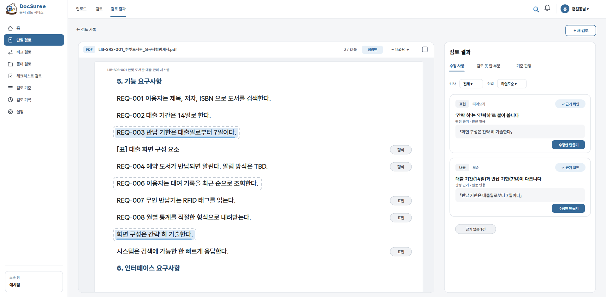
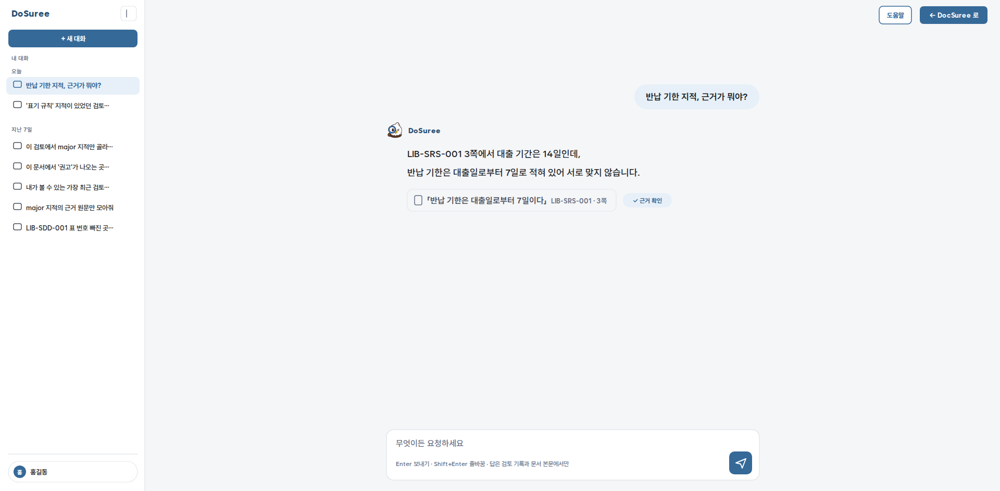
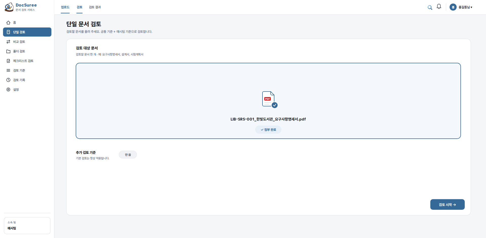

<div align="center">


<sub>화면 속 문서 · 이름은 가상의 샘플입니다 · <a href="docs/manual/film/">영상 원본</a></sub>

# DocSuree

### 근거를 원문에서 대조해 통과한 것만 지적하는 문서 검토 Agent

**Doc** + **Suree** — 문서를 살피는 독수리, 문서를 修理하는 검토자, 근거로 확신하는 **Sure**.


</div>

---

## DocSuree는 무엇을 하는가

PDF·Word·HWP 산출물을 올리면 팀의 검토 기준에 따라 **형식·완전성·표현·정합성·추적성**을
검사하고, 지적 위치를 원문 위에 형광펜으로 짚은 리포트를 냅니다.
규칙으로 잡을 수 있는 것은 규칙으로 잡고, 규칙으로 못 잡는 것만 LLM에게 묻습니다.

> **모델은 근거를 찾고, 코드가 그 근거를 검증합니다.**
> 환각은 모델에게 되묻지 않고 코드로 막습니다.

<table>
  <tr>
    <td width="33%" valign="top">
      <h3>📌 원문 인용 필수</h3>
      <p>LLM 지적은 반드시 원문을 그대로 인용해야 합니다. 결론만 있는 후보는 채택하지 않습니다.</p>
    </td>
    <td width="33%" valign="top">
      <h3>🚫 문자열 대조 게이트</h3>
      <p>인용이 문서에 실재하는지 공백만 정규화해 대조합니다. 통과한 근거가 없으면 지적을 폐기하고, 버린 건수는 INFO로 드러냅니다.</p>
    </td>
    <td width="33%" valign="top">
      <h3>🧾 미검토 공개</h3>
      <p>"0건 통과"와 "검토를 못 했다"를 섞지 않습니다. LLM 실패·절단·기준 누락은 미검토로 남깁니다.</p>
    </td>
  </tr>
  <tr>
    <td valign="top">
      <h3>📐 기준이 검사를 이끈다</h3>
      <p>공통 → 팀 → 업로드 3층 기준을 병합합니다. 팀명·규칙값은 엔진에 없고 기준 파일에만 있습니다.</p>
    </td>
    <td valign="top">
      <h3>🏢 전 과정 사내망</h3>
      <p>문서를 외부 LLM API로 보내지 않습니다. 외부 어댑터는 고를 수조차 없게 지웠습니다.</p>
    </td>
    <td valign="top">
      <h3>🧩 모듈형 구조</h3>
      <p>파서·LLM 창구·기준·리포트·검사 Agent가 독립 모듈입니다. 폴더째 떼어 다른 프로젝트에서 씁니다.</p>
    </td>
  </tr>
</table>

## 실제 검토 화면



원문 형광펜과 지적 목록을 나란히 봅니다. 검토자는 지적마다 반영·해당없음을 판정하고,
회신본을 올리면 이전 검토와 대조해 **반영 확인**(이전 지적별 상태 · 신규 지적)을 받습니다.

**비교 검토**는 상위 문서(요구사항)와 하위 문서(설계서)를 나란히 올려, 상위 요건이 하위 문서에
반영됐는지 · 빠진 것 · 근거 없는 것을 찾습니다. 요건 ID 형식은 소속 팀 기준에서 가져오고,
하위 문서가 일부 요건만 맡았다면 맡은 범위를 좁혀 "누락"으로 잘못 세지 않게 합니다.

## 주요 기능

<table>
  <tr>
    <td width="50%" valign="top">
      <strong>검토</strong>
      <ul>
        <li>단일 문서 검토 — 산출물 종류 자동 감지</li>
        <li>문서 2건 비교 — 요건 추적성·내용 대조</li>
        <li>누락 요건이 다른 표현으로 있는지 찾아 주기</li>
        <li>폴더 단위 산출물 묶음 검토</li>
        <li>체크리스트 검토 — 문서 + 과제 평가 체크리스트 → 평가표 초안</li>
        <li>서버 백그라운드 작업 — 진행 표시·취소·완료 알림</li>
      </ul>
    </td>
    <td width="50%" valign="top">
      <strong>결과</strong>
      <ul>
        <li>원문 PDF 형광펜 · 지적 위치로 이동</li>
        <li>Markdown · PDF 리포트</li>
        <li>검토 결과 Excel · 팀 서식 추적성 매트릭스(RTM)</li>
        <li>체크리스트 항목별 판정 · CSV 내보내기</li>
        <li>회신본 반영 확인 · 검토 이력 재열람</li>
      </ul>
    </td>
  </tr>
  <tr>
    <td valign="top">
      <strong>검토 기준</strong>
      <ul>
        <li>공통 → 팀 → 업로드 3층 병합</li>
        <li>기준 한 줄의 <code>check:</code>가 검사기를 고른다</li>
        <li>검사기가 없는 기준은 "규칙 없음"으로 공개</li>
        <li>팀 체크리스트를 올려 라이브러리로 등록 · 재사용</li>
      </ul>
    </td>
    <td valign="top">
      <strong>운영</strong>
      <ul>
        <li>로그인 · 소속 팀 · 일반/관리자 2등급</li>
        <li>업로드 원본 30일 뒤 자동 삭제(리포트·이력은 유지)</li>
        <li>DoSuree 어시스턴트 — 검토 결과를 두고 대화 (선택)</li>
      </ul>
    </td>
  </tr>
</table>

## 검사 구성

규칙 검사는 LLM 없이 돌고, LLM 판정은 `llm_client` 한 창구로만 나갑니다.

| 구분 | 검사기 (`check:` 이름) |
|---|---|
| 형식·완전성 | `completeness` 필수 절 · `toc` · `toc_appendix` 목차 · `header_footer` · `fontsize` · `filename` · `placeholder` · `field_presence` |
| 표현·품질 | `text_pattern` 금지 표현 · `abbrev` 약어 등록 · `consistency` 앞뒤 모순·모호 (LLM) |
| 정합성·추적성 | `reflist` 참고문헌 대조 · `field_match` 갑지·을지 값 대조 · `rtm_forward` · `rtm_reverse` 요건 추적 · 누락 요건 내용 대조 (LLM) |

모든 검사기는 공통 Finding 스키마를 돌려줍니다 —
`check_id · agent · severity(major|minor|info) · kind · location · finding · evidence · suggestion · status`.
심각도는 **"이 지적이 남아 있으면 팀이 이 문서를 그대로 낼 수 있는가"** 한 문장으로 가릅니다.
단일 점수(100점 만점)는 **두지 않습니다** — 정답 셋으로 눈금을 검증하기 전까지는 심각도별 건수만 말합니다.

## 체크리스트 검토

팀이 쓰는 **과제 평가 체크리스트(xlsx)** 를 그대로 올리면, 문서를 그 잣대로 훑어
항목마다 판정 제안 · 근거 절 · 원문 인용이 달린 **평가표 초안(부록 B)** 을 만듭니다.

```text
체크리스트 시트 → 항목 읽기 (ID · 평가 항목 · 평가 관점 · 대상 문서)
    ↓ 항목마다
떠올리기 (LLM) — 무엇을 찾아야 이 항목을 판정할 수 있나
찾기    (코드) — 문서에서 해당 절 · 문장 검색
확인    (LLM) — 찾은 근거로 판정 제안 · 원문 인용
대조    (코드) — 인용이 문서에 실재하는지 확인
    ↓
초안 작성 · 근거 없음 · 미검토  ← 세 상태를 섞지 않는다
    ↓
평가표 Excel 내보내기
```

판정은 **제안**이고 확정은 검토자가 합니다. 근거를 못 찾은 항목은 "근거 없음"으로,
LLM 실패 등으로 판단을 못 한 항목은 "미검토"로 따로 셉니다.
체크리스트 라이브러리에 등록해 두면 단일 검토에서 체크리스트를 골라 항목별로 채우고
CSV로 내보낼 수도 있습니다.

## DoSuree 어시스턴트



검토 결과 화면 옆 패널(우하단 마스코트)에서 **DoSuree** 와 대화합니다.
"이 지적은 왜 나왔지?", "문서에 보안 요구사항이 어디 있지?" 처럼 결과와 원문을 두고 묻습니다.

- DoSuree는 사내 에이전트 CLI입니다. 서버가 사용자마다 화면 없이(`--mode rpc`) 띄웁니다.
- DoSuree는 DocSuree의 `/mcp`(MCP 서버)로 검토 결과를 **읽기 전용 도구**로 읽습니다:
  `list_reviews` · `get_review` · `search_findings` · `find_in_document` · `list_sections` · `read_section`.
- 쓰기 도구는 없습니다. 판정·삭제·기준 수정은 웹에서만 합니다. 권한은 그 사용자의 웹 권한과 같습니다.
- 대화는 사용자 폴더에 남고 30일 뒤 지웁니다.
- 설정 `[chat] dsr_bin` 에 DoSuree 실행 파일 경로를 줘야 켜집니다. 비우면 패널이 나타나지 않습니다.
  연결 토큰은 `uv run docsuree accounts token <email>` 로 발급합니다.

## 검토 흐름



```text
문서 업로드 (PDF · DOCX · HWP · HWPX · MD · TXT)
    ↓
doc_parser — 공통 문서 모델(JSON 직렬화 가능)로 정규화
    ↓
preset — 산출물 종류 감지 → 공통·팀·업로드 기준 병합
    ↓
규칙 검사기 ─┬─ LLM 검사기 (원문 인용 필수)
             ↓
Validator — 인용 ↔ 원문 문자열 대조, 실패 시 재질의 후 폐기
    ↓
확정 지적 · 미검토 · 폐기 건수(INFO)
    ↓
판정 · 회신본 반영 확인 · 리포트(MD · PDF · Excel · RTM)
```

## 시스템 구조

```text
┌─────────────────────────────────────────────────────────────────┐
│ Web UI · Vanilla SPA (web/)                                     │
│ 로그인 · 업로드 · 작업 진행(SSE) · 결과 · pdf.js 형광펜 · 어시스턴트 │
└──────────────────────────────┬──────────────────────────────────┘
                               │ HTTP / SSE
┌──────────────────────────────▼──────────────────────────────────┐
│ FastAPI · src/app                                               │
│ review · compare · evaluate · jobs · history · auth · mcp       │
└──────────────────────────────┬──────────────────────────────────┘
                               │ 공개 인터페이스만
  ┌──────────┬─────────┬───────┴──────┬──────────────┬──────────┐
doc_parser  preset  llm_client   agent_* (6종)     report    shared
                        │
                  사내 vLLM (Qwen3) · VLM
```

모듈은 DocSuree를 모르고 공개 인터페이스로만 연결됩니다. 조립은 `src/app/`만 합니다.
엔진 내부(체커별 동작·기준 라우팅·Validator)는 [ENGINE.md](ENGINE.md)에 있습니다.

## 지원 문서

| 형식 | 파싱 | 원본 레이아웃 뷰어 | 비고 |
|---|:---:|:---:|---|
| 디지털 PDF | ✅ | ✅ | pdf-inspector + PyMuPDF + Docling, 실패 시 pdfplumber 폴백 |
| 스캔 PDF · 그림 | ✅ | ✅ | 사내 VLM(`LLM_OCR_URL`). 미설정이면 읽지 않았다고 미검토로 보고 |
| HWP | ✅ | ⚙️ | rhwp 네이티브 파싱, 그림 포함 |
| HWPX · DOCX | ✅ | ⚙️ | 포맷별 네이티브 파서 |
| Markdown · TXT | ✅ | — | 원문 그대로 |

> ⚙️ 파싱과 뷰잉은 별개입니다. 원본 레이아웃 뷰어는 LibreOffice로 PDF를 만들어 보여 주며,
> 없어도 검토는 동작합니다(텍스트 재현본으로 표시). Docker 이미지에는 들어 있습니다.

## 구현 상태 (1차 배포 기준)

| 영역 | 상태 |
|---|---|
| PDF · DOCX · HWP · HWPX · MD 파싱, 스캔·그림 VLM 해석 | ✅ |
| 규칙 검사기 · LLM 검사기 · 인용 대조 Validator | ✅ |
| 단일 검토 · 2문서 비교 · 폴더 검토 · 반영 확인 | ✅ |
| 체크리스트 검토(평가표 초안) · 체크리스트 라이브러리 | ✅ |
| 리포트 MD · PDF · Excel · RTM | ✅ |
| 계정·권한 · 백그라운드 작업 · 원본 30일 삭제 | ✅ |
| Docker 반입 이미지(폐쇄망) | ✅ |
| DoSuree 어시스턴트(MCP 읽기 전용) | 🚧 선택 기능, `dsr_bin` 설정 시에만 켜짐 |
| 정답 문서 셋(`golden/`) 자동 재검증 | ⏳ 미구축 |
| 점수 산출 | ➖ 의도적 제외 |

**알려진 한계**
- 팀 기준 중 검사기가 붙은 것은 일부입니다. 나머지는 화면에 "이 기준을 검사하는 규칙이 아직 없습니다"로 뜹니다.
- 요건 ID 형식(`id_pattern`)을 적지 않은 팀은 추적성 비교가 미검토로 남습니다.
- `consistency`(LLM)가 지적의 대부분을 내고 minor 비중이 높습니다. 등급 재배치 전에 분량부터 검토 중입니다.

## 빠른 시작

### 개발 (로컬)

```bash
uv sync                       # 웹·전 포맷 파서·Docling 까지 한 번에 (처음엔 수 GB)
export LLM_QWEN_URL=http://<서버>:9001/v1   # 문서 검사 LLM
export LLM_OCR_URL=http://<서버>:9002/v1    # 그림·스캔 해석 (선택)
uv run docsuree serve         # http://127.0.0.1:8000
```

LLM 주소는 저장소에 적지 않습니다. `.env`(gitignore)에 두고 `source` 하세요.
`.hwp`를 검토한다면 Linux에서 `./scripts/fix-rhwp-freetype.sh`를 한 번 실행합니다.

### CLI

```bash
uv run docsuree review 검토할문서.pdf --out report.md
uv run docsuree compare --parent 상위문서.pdf --child 하위문서.docx
uv run docsuree accounts --help      # 계정 조회·권한 변경
```

### 배포 (Docker · 폐쇄망)

```bash
# 인터넷 되는 기계에서 — 이미지 조립 + 자체 점검 + 반입 파일(약 2.4GB)
./scripts/build-image.sh

# 사내 서버에서
docker load < docsuree-<날짜>.tar.gz
docker compose up -d                  # LLM 주소는 docker-compose.yml 환경변수로
```

> 포트는 기본 `127.0.0.1`에만 엽니다. 팀 전체에 열 때는 앞에 리버스 프록시를 두세요.
> 업로드 한도는 30MB입니다.

## 저장소 구조

```text
DocSuree/
├── src/
│   ├── app/                  # API · 화면 · 계정 · 작업 큐 조립부
│   └── modules/
│       ├── doc_parser/       # PDF · HWP · HWPX · DOCX · MD → 공통 문서 모델
│       ├── llm_client/       # 사내 vLLM · VLM 단일 창구
│       ├── preset/           # 검토 기준 3층 병합 · 산출물 감지
│       ├── report/           # MD · PDF · Excel · RTM · 형광펜
│       ├── shared/           # 공통 Finding 스키마 · 문서 도구
│       ├── agent_format/     # 형식·완전성
│       ├── agent_quality/    # 표현·내용 품질
│       ├── agent_trace/      # 정합성·추적성
│       ├── agent_checklist/  # 표준·체크리스트
│       ├── agent_generate/   # 작성·생성 지원 (평가표 초안)
│       └── agent_history/    # 의견·이력 (반영 확인)
├── web/                      # 바닐라 JS SPA · public/ 런타임 자산
├── presets/criteria/         # 공통 기준 + 팀 기준 예시 (운영 팀 기준은 담지 않음)
├── config/settings.toml      # LLM·청킹 설정 (주소는 환경변수)
├── tests/                    # pytest · web/tests/ 는 JS 단위 테스트
├── Dockerfile · docker-compose.yml
└── ENGINE.md                 # 엔진 상세
```

## 개발

```bash
uv run pytest -q
uv run ruff check .
```

- 브랜치 `feat|fix|docs/<주제>`, 커밋 `타입: 한국어 요약`. main 직접 커밋 금지 ([GIT_CONVENTIONS.md](GIT_CONVENTIONS.md)).
- 공개 함수는 타입 힌트, 비트리비얼 로직에는 실행 가능한 테스트 하나 이상.
- 새 모듈은 `src/modules/<이름>/`에 README(입출력·의존성) + `__init__.py` 공개 인터페이스 + `tests/`.
- 실문서 테스트는 `data/`(gitignore)를 이름으로 찾고, 없으면 사유를 남기고 skip 합니다.

## 보안 및 프라이버시

> **이 저장소는 공개판입니다.** 회사 안에서 쓰는 저장소가 따로 있고, 밖으로 나가면
> 안 되는 것을 덜어낸 뒤 커밋 하나로 냅니다. 뺀 것은 이렇습니다.
>
> - **팀별 검토 기준** — 고객사 요구사항에서 뽑은 것이라 공개하지 않습니다.
>   대신 같은 형식으로 쓴 예시 파일 `example-team.yaml` 하나를 넣었습니다.
> - **그 기준이 있어야 돌아가는 테스트** — 기준을 뺐으니 같이 뺐습니다.
> - **주석과 테스트에 적혀 있던 실제 문서 이름·고객사 이름** — 가짜 이름으로 바꿨습니다.
> - **화면 사진** — 문서 내용과 문서 이름, 사람 이름을 가렸습니다.

- 문서 원본은 외부 LLM 서비스로 보내지 않습니다. 모델 호출은 설정된 사내 엔드포인트로만 나갑니다.
- 업로드 원본은 30일 뒤 자동 삭제됩니다.
- `.env`·인증키·사내 문서 원본·50MB 이상 파일은 커밋하지 않습니다(`data/`·배포 반입 파일은 gitignore).

---

<div align="center">
  
  <br />
  <strong>DocSuree</strong> — 못 한 것을 못 했다고 말하는 문서 검토 Agent
</div>
